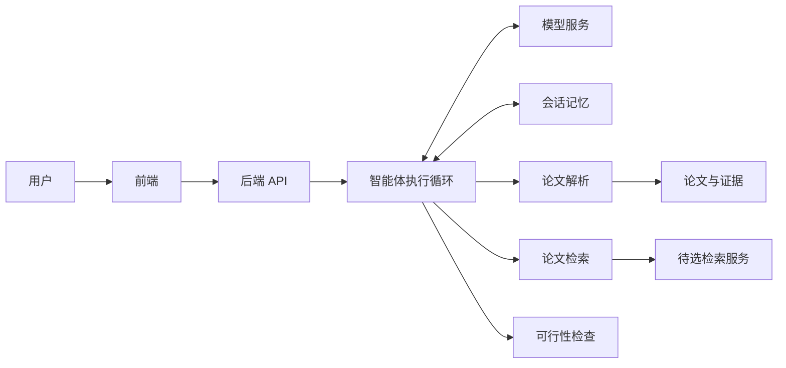

# 系统架构与职责

## 目标流程

了解专业方向与已读论文 → 按需追问资源约束 → 解析论文 → 使用解析结果检索相关研究 → 提出候选 idea → 检查实验可行性 → 多轮调整 → 输出研究方案。

当前只完成工程框架。下述模型、工具执行与状态存储均为后续设计，不代表已具备的能力。

## 模块边界

- `api`：校验请求、传递会话标识、返回回复或错误。
- `agent`：判断信息是否充分，按需追问，选择和执行工具，检查步数与结束条件。追问属于对话决策，不单独强制做成工具。
- `tools`：接收明确参数、返回可核对结果；可独立测试，不依赖前端。
- `services`：封装模型服务协议、超时、错误转换。地址、名称与密钥从后端环境变量读取。
- `memory`：按会话标识读写状态，支持更正覆盖和清除。第一版存储方案待实现。

## 两项工具的数据依赖

论文解析返回实际的研究问题、方法关键词和证据 → 智能体据此构造检索条件 → 论文检索返回相近工作的元数据和来源链接。检索查询不能用预置的固定结果冒充解析输出。

可行性检查还可以读取论文实验所需资源，与用户资源约束比较；信息不足时返回未知项或触发追问。

## 未来会话状态

建议保存 `session_id`、研究方向、参考论文、时间与算力约束、候选 idea、被否定的方向及原因、最近对话、工具中间结果与证据引用。用户更正约束后更新结构化事实；历史裁剪不能丢失仍有效的约束。不同会话严格隔离。

## 未来输出

研究问题、相关论文依据、待验证的创新假设、资源可行性、最小验证实验（基线、数据、指标和对照）、风险与替代方案。文献检索只能帮助核查相关工作，不能保证 idea 的绝对新颖性。
